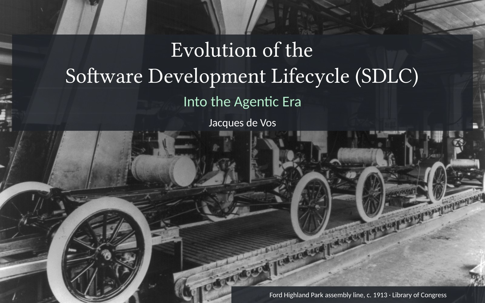
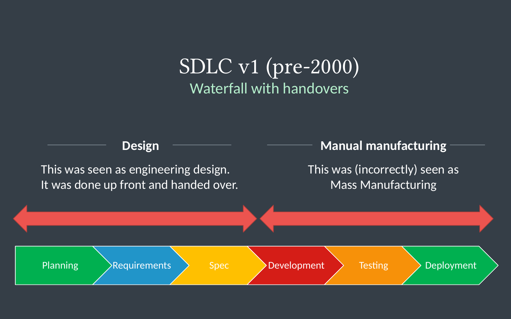
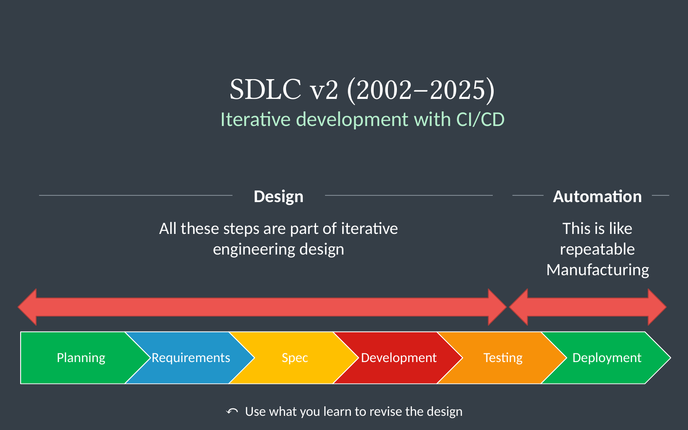
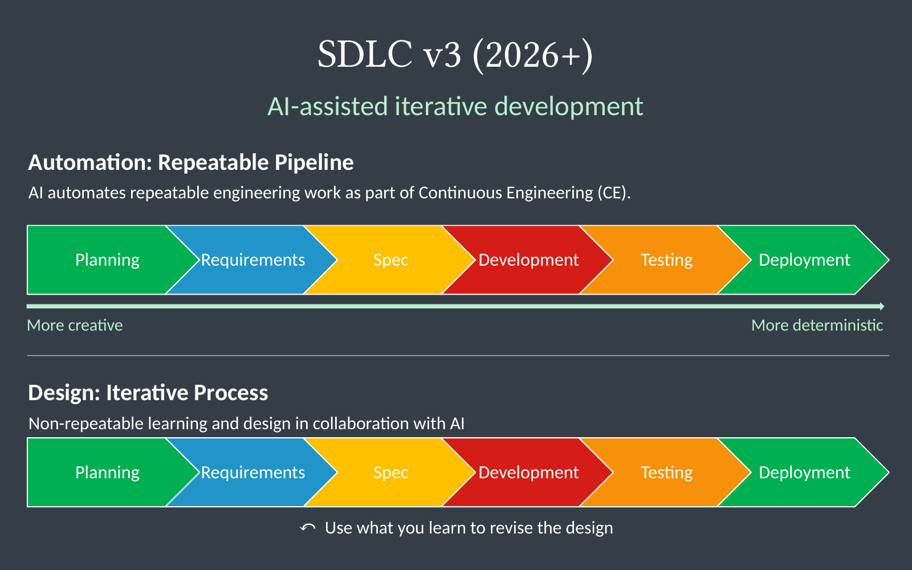

*Into the Agentic Era*

## SDLC in the Agentic Era

In 2026, software engineering is undergoing its most dramatic change yet.

So how does this change the disciplined software engineering process?

Let’s look at how the lifecycle evolved to understand it.

<!--more-->

## What can we learn from this change?

1. **Automation: Move from CI/CD to CE**

   CE is Continuous Engineering.

   Use AI to automate repeatable work throughout the lifecycle that CI/CD alone could not automate before.

2. **Design: Use the extra room to iterate**

   AI makes it easier to try, test and revise a design. As in earlier versions of the SDLC, a focus on automation and handovers can obscure the design loop.

3. **Tooling: Build end-to-end pipelines**

   Today’s tooling is split between agentic development environments (ADEs) and traditional CI/CD tools. I’d like to see them joined in one pipeline that carries a change from specification through delivery in a disciplined way.
